# pr-results

<p align="center"></p>

<p align="center">
  <a href="https://github.com/liminal-hq-labs/pr-results/actions/workflows/ci.yml"></a>
  
  
</p>

pr-results reads the test and check results your CI produces and posts them to the pull request: one sticky comment for the whole run and one check run per suite, with annotations at the failing file and line. It reads JUnit from nextest (tuned) and step reports from shell-script projects (tuned), and from vitest, bun, jest and Playwright (parsed, tuned in v0.2), and it is safe on pull requests from forks by design.

> **Status:** experimental and **not released**. The data model, the escaping type, the JUnit parsers, the renderer, the GitHub client and publish flow, the command line (`publish`, `render` and `validate-config`), the settings file, the composite action and the reusable workflow are built and tested against an in-memory GitHub. Nothing has talked to the real API or run on GitHub Actions yet, and there is no release or binary: the action and the reusable workflow stop with a message until a release fills in the binary digests, and the action's `build: source` builds the checkout. Interfaces and formats may change between any two commits.

## What it's for

- A pull request that runs several suites and should get one calm comment, not one bot comment per suite.
- Pull requests from forks and Dependabot, where a test job's read-only token cannot post results, and the publisher runs afterwards through `workflow_run` instead.
- A project that runs shell steps, where a red job should name the step that broke and how long each step took.
- A reviewer who wants the failing file and line annotated in the diff, and flaky tests kept apart from real failures.
- An owner who wants every string from a test report escaped by one audited path, with the publisher pinned to a commit.

## What the comment will look like

This is a **mock** of the comment, written by hand in the shape of the renderer's output to show the layout. The renderer and the command line exist; nothing has posted it to a real pull request yet.

> ### Example checks: 1 failure in 2 suites
>
> | Suite | Result | Passed | Failed | Skipped | Flaky | Time |
> | --- | --- | ---: | ---: | ---: | ---: | ---: |
> | `Desk steps` | **Failed** | 23 | 1 | 4 | 0 | 6 m 12 s |
> | `Rust tests` | Passed | 672 | 0 | 0 | 1 | 47.0 s |
>
> #### Failures
>
> Failure 1 of 1
>
> `Desk steps` › `check (dos)` › `Emulator` › `Example binary in a headless emulator`
>
> `exit status 1` · 18.2 s
>
> Flaky: passed after a retry (1)
>
> - `Rust tests` › `core` › `blit::clips_at_the_right_edge`: failed once, passed on attempt 2

In the real comment each failure is a `<details open>` block and the flaky list is a collapsed `<details>`.

The full layout is in [docs/adopting.md](docs/adopting.md#what-the-comment-looks-like).

## Install and run

**Not released yet.** The setup is a small reusable workflow in your repository that runs after your CI finishes, pinned by full commit SHA. The SHA below is a placeholder, because there is no release to pin yet, and the workflow stops with a message until there is:

```yaml
# .github/workflows/publish-test-results.yml
name: Publish Test Results

on:
  workflow_run:
    workflows: [CI]
    types: [completed]

permissions: {}

jobs:
  publish:
    if: github.event.workflow_run.conclusion != 'skipped' && github.event.workflow_run.conclusion != 'cancelled'
    permissions:
      actions: read # list and download the run's artefacts
      checks: write # create and update check runs and annotations
      pull-requests: write # create and update the sticky comment
      contents: read # check out .github/ from the default branch
    uses: liminal-hq-labs/pr-results/.github/workflows/publish.yml@<full commit sha> # v0.1.0
```

Your CI uploads its results as artefacts (`rust-test-results`, `frontend-test-results`, `event-file` and so on), and the publisher does the rest. See [docs/adopting.md](docs/adopting.md) for the steps, a recipe for each test runner (nextest, vitest, Playwright shards, bun and Desk) and the optional `.github/pr-results.toml`.

## Documentation

- [SPEC.md](SPEC.md) — behaviour and interfaces
- [docs/adopting.md](docs/adopting.md) — setting it up in a repository
- [docs/inputs.md](docs/inputs.md) — the formats it reads
- [docs/security.md](docs/security.md) — how it treats untrusted input
- [docs/decisions.md](docs/decisions.md) — decisions and why
- [CHANGELOG.md](CHANGELOG.md) — what changed
- [AGENTS.md](AGENTS.md) — contributor and agent rules

## Contributing

Issues and pull requests are welcome. The house rules are in [AGENTS.md](AGENTS.md); run the checks it lists before opening a pull request.

## Part of Liminal HQ Labs

pr-results is a [Liminal HQ Labs](https://github.com/liminal-hq-labs) experiment. Experiments from Liminal HQ — early, rough and open. If it proves itself, it [graduates](https://github.com/liminal-hq-labs/.github/blob/main/docs/labs-charter.md#graduation) to [Liminal HQ](https://github.com/liminal-hq).

## Licence

Licensed under either of the [Apache License, Version 2.0](LICENSE-APACHE) or the [MIT licence](LICENSE-MIT), at your option.
